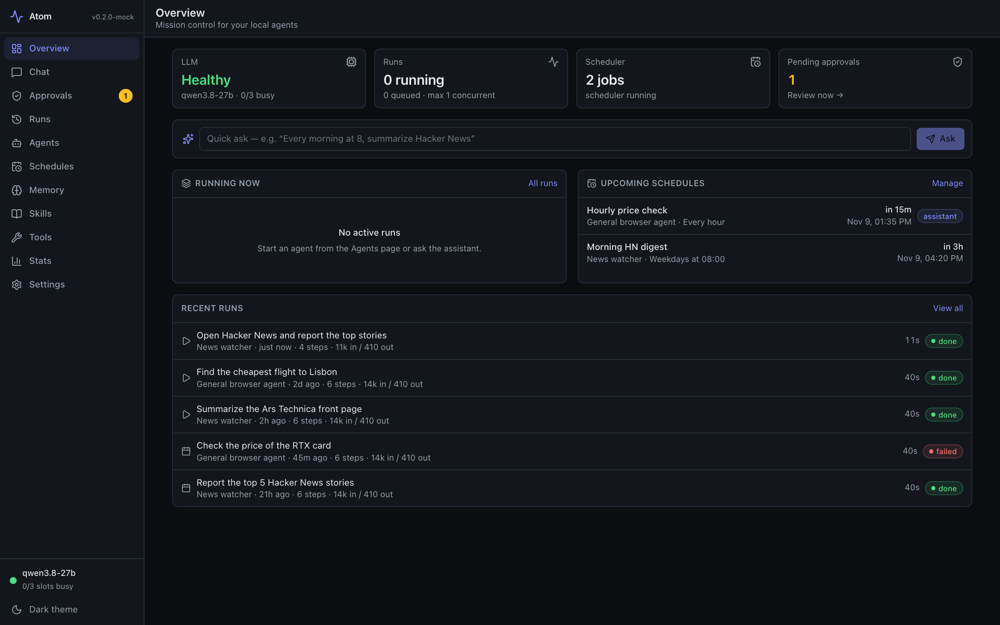
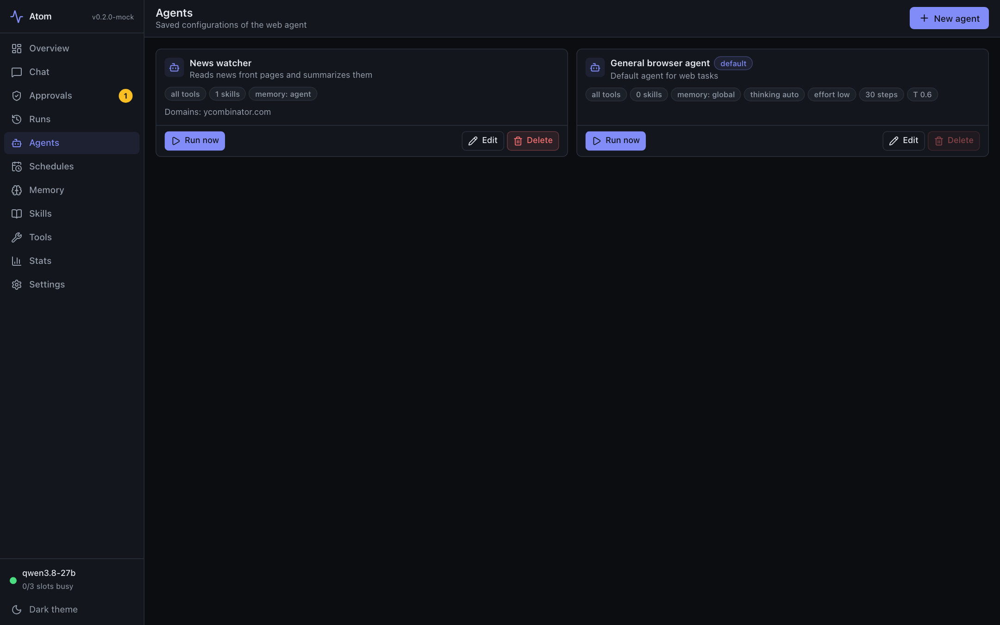
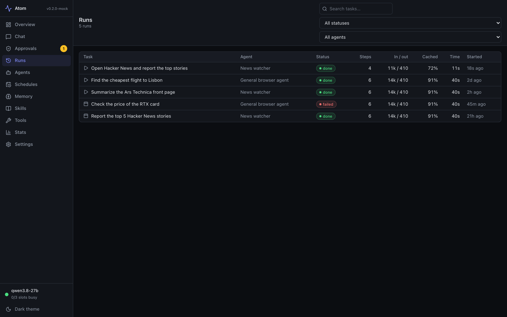
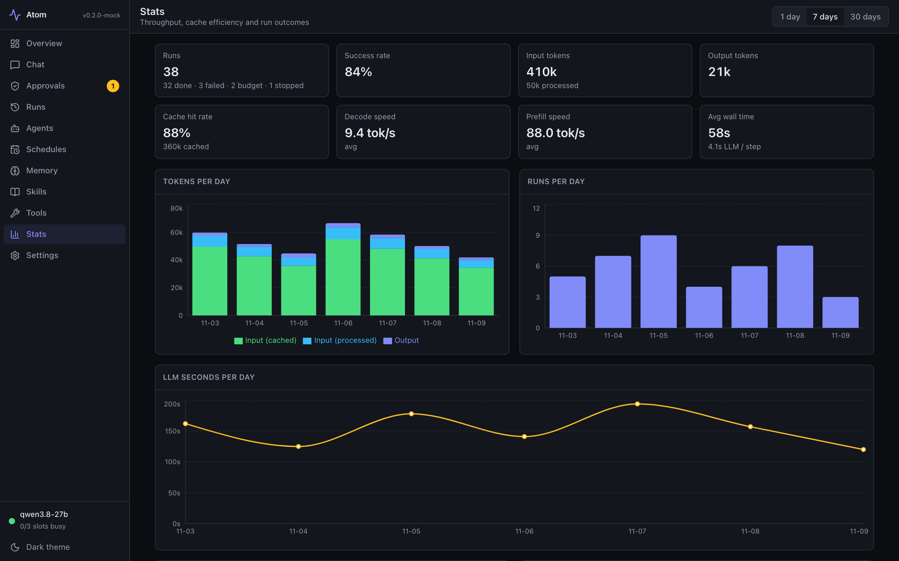
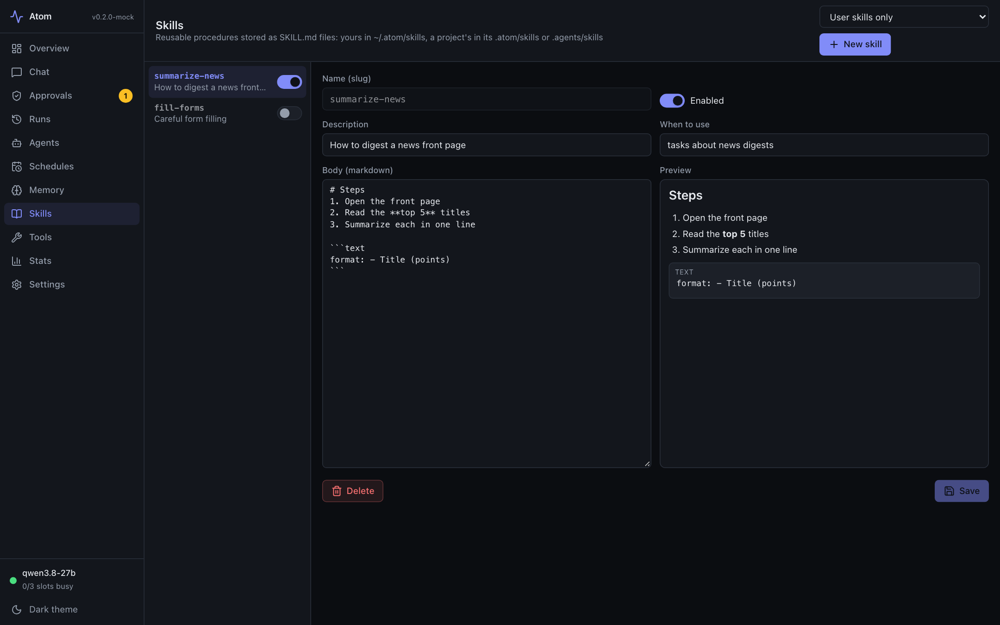

<h1 align="center">Atom</h1>

<p align="center">
  <a href="https://alexander-uspenskiy.github.io/Atom/"><b>Website</b></a> ·
  <a href="#run">Get started</a> ·
  <a href="docs/DASHBOARD_API.md">API</a>
</p>

<p align="center"></p>

**Your own AI agent that uses the web like you do, running entirely on your Mac.** Atom drives a real browser (Playwright) with a local 27B model on llama.cpp. No cloud API, no per-token bill, and your data and passwords stay on your machine. Built for an M1 Max 64 GB.

## What you get

- **A real browser agent**: it clicks, types, reads and navigates real sites, with live screenshots and a step-by-step timeline you can watch or stop.
- **Fully local and private**: Qwen3.8-27B or NousResearch Arete-27B (4-bit GGUF). Nothing leaves your machine unless you connect it.
- **Switch models in one click**: list, download, start, stop and choose the default model from the dashboard, or give each agent its own model.
- **Scheduled agents**: cron-style schedules run tasks while you sleep, with run history, traces and screenshots.
- **Chat assistant**: ask in plain language; it proposes schedules, agents, skills and memories, and you approve them. Attach images (OCR / vision) and documents (PDF, Word, Excel, CSV, Markdown, text).
- **Long chats that don't forget**: a context ring shows usage and older messages are summarised automatically (or on click).
- **Telegram**: chat with Atom from your phone, send photos and files, approve actions with buttons, get run results and screenshots back, forward results to people you whitelist.
- **Gmail**: search, read and (optionally) send email, with Google sign-in (OAuth, no password stored) and several accounts.
- **Extensible connectors**: add your own integration by subclassing `Connector`; the settings form is generated for you.
- **MCP servers**: plug in any MCP tool server (stdio or remote); its tools appear to your agents.
- **Skills and memory**: reusable procedures (user-level, project-level or built in) and persistent memories, scoped globally or per agent.
- **Terminal tools and projects**: agents and chat can run commands in a chosen working folder.
- **Secrets done right**: `{{NAME}}` variables and keychain-stored secrets that the model never sees and that are scrubbed from logs.
- **Safe by default**: domain allowlists, private-network blocking, untrusted-content handling and human approval for anything persistent.
- **Live dashboard**: Overview, Chat, Agents, Schedules, Runs, Memory, Skills, Stats, Settings and Approvals, with light and dark themes.
- **Tested and measured**: a test suite that needs no model, plus an eval harness to compare models.

## Screenshots

| Agents | Runs |
|---|---|
|  |  |
| **Stats** | **Skills** |
|  |  |

## Run

```sh
ops/start.sh                      # model server (:8080) + dashboard backend (:8787); Ctrl+C stops both
open http://127.0.0.1:8787        # the dashboard
```

Pieces separately: `ops/llama-server.sh [qwen|arete]` (3 slots: agent / extraction+thinking / chat) and `uv run python -m atom serve`.

## Use

- **Dashboard** (`web/`, React): Overview, Chat, Agents, Schedules, Runs (live view), Memory, Skills, Stats, Settings, Approvals.
- **CLI**: `uv run python -m atom run "task" --url https://example.com [--agent NAME] [--thinking off|auto|on]`,
  `atom runs`, `atom show <run_id>`, `atom llm-check`.
- **Evals**: `uv run python -m evals.run_evals --suite all [--repeat N] [--profile qwen|arete]` (5 local fixture tasks + 2 live); results go to `evals/results/phase1_<profile>_<time>.json`.
- **Tests**: `uv run pytest` (no model needed; uses a scripted fake LLM and a local fixture site).
- **Frontend dev**: `cd web && pnpm install && pnpm dev` (proxies /api to :8787); `pnpm build` writes `web/dist`.

## Models

Two model profiles (`atom/config.py: LLM_PROFILES`), each its own llama-server on its own port, so both can be loaded at
once: **qwen** (Qwen3.8-27B, UD-Q4_K_M, :8080, default) and **arete** (NousResearch Arete-27B, Q4_K_M, :8081). Click the
model name in the dashboard sidebar to list, switch the default, start, stop or download a profile (`/api/models`).
Atom can stop only servers it started itself. An agent can pick its own model (Agents → Model; empty = default), and its
runs route LLM calls to that server. Start one by hand with `ops/llama-server.sh arete`.

## Chat context

The chat shows a context ring (used / budget of the 32k chat slot). At the "Summarise chats at" share (Settings, default
75 %) older messages are folded into a rolling summary and old tool output is pruned; click the ring to compact now.
The transcript stays intact. Details: `docs/CONTEXT.md`.

## Environment & secret variables

Settings → "Environment & secrets" stores named values (`/api/variables`, SQLite, plain text, local only). Agents use
them by writing `{{NAME}}` inside a tool argument; the value is filled in when the tool runs. Plain variables are listed
(with values) in the agent's prompt. Secrets are never shown to the model or the API: they work only with `type`,
`select_option`, `open_url` and `mcp_*` tools, can be limited to domains, and are scrubbed from tool output and run logs.

## Connectors

Settings → Connectors adds first-party integrations (`/api/connectors`). Currently **Gmail** (IMAP/SMTP): tools
`gmail_<name>_search` (Gmail search syntax), `gmail_<name>_read`, and `gmail_<name>_send` only when "Allow agents to
send email" is on (off by default, since email content is untrusted input). Several accounts can be connected.

**Sign in with Google (recommended):** in Google Cloud Console create an OAuth client of type *Desktop app* (consent
screen: add yourself as a test user, or publish it as "In production" for personal use, otherwise Google expires the
token after 7 days). Enable IMAP in Gmail. Save the client ID/secret on the connector and click *Sign in*; the browser
completes the OAuth flow (PKCE, loopback redirect to the dashboard's own address) and no password is stored. Alternative:
a Google app password. All connector secrets (client secret, app password, refresh token) are kept in the system
keychain, never in the database.

**Telegram** (chat with Atom from your phone): in Telegram message @BotFather, send `/newbot`, name it "Atom" and pick a
username ending in `bot`. In Settings → Connectors add a Telegram connector with the token (kept in the keychain). The bot
long-polls Telegram, so nothing is exposed to the internet. Only user IDs listed under "Allowed user IDs" can use it:
save it empty, message the bot once, and it replies with your ID; then add the ID. Messages go to the dashboard assistant
(one conversation per user, visible on the Chat page; `/new` starts a fresh one). Proposals (schedules, agents, ...) arrive
with Approve / Reject buttons. Send a photo or a document (PDF, Word, Excel, CSV, Markdown, text file), optionally with a caption, and the assistant reads it, same as a file attached in the dashboard chat. Ask it to show you a run's screenshot and it sends the picture back. Agents can attach a page screenshot to `telegram_<name>_send` (`include_screenshot`). "Forwarding recipients" lists Telegram user IDs (each must press Start in the bot once) that a job may copy its message to: only when the job's instruction says e.g. "forward to 987654321", and only IDs on that list; a failed copy never fails the run. With "Let agents message me" on, agents get `telegram_<name>_send` to notify you from
scheduled runs. Private chats only.

To add a connector type, subclass `Connector` in `atom/connectors/`, declare its `fields` (and `oauth` if it signs in
through the browser) and `build_tools`, and `register()` it; the UI form is generated from the field schema. Connectors that listen for events (like Telegram) set
`background = True` and implement `run(name, cfg, svc)`; the manager runs it while the connector is enabled and restarts it on config changes.

## MCP servers

Agents can use tools from MCP servers. Put them in `data/mcp.json` (standard `mcpServers` format; stdio via
`command`/`args`/`env`, or remote via `url`/`headers`; `"disabled": true` skips one), then restart or
`POST /api/mcp/reload`. Status: `GET /api/mcp`. Tools appear as `mcp_<server>_<tool>` in `/api/tools` and agent
tool pickers; results are wrapped as untrusted data. Tools without a read-only hint are flagged `side_effect`.

## Layout

```
atom/            backend: agent loop, browser layer, tools, scheduler, stores, assistant, FastAPI app
  browser/       Playwright session, compact snapshots, readable text
  server/        REST + SSE API (contract: docs/DASHBOARD_API.md)
web/             dashboard frontend
evals/           eval tasks, local fixture site, results
ops/             start scripts
data/            SQLite db, run traces + screenshots   (gitignored)
~/.atom/skills/  user-level skills (SKILL.md folders); a project folder adds <folder>/.atom/skills or <folder>/.agents/skills
```

## Notes

- Prefill is the slow part on this hardware (~100-125 tok/s) and decode is ~13 tok/s. The agent keeps history
  append-only so llama-server's prompt cache is reused (steps typically re-read only 100-300 new tokens).
  Thinking mode always breaks the cache for that call, so it is off by default and `auto` only uses it to recover.
- Anything the assistant or an agent wants to persist (schedules, agents, skills, memories) is a pending action
  you approve in the UI, unless "Auto-approve assistant actions" is on in Settings.
- Page text and tool results are treated as untrusted data; navigation is checked against per-agent domain allowlists
  and private-network addresses are blocked unless an agent explicitly allows them.
